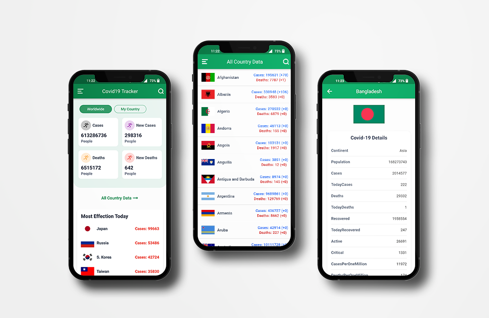
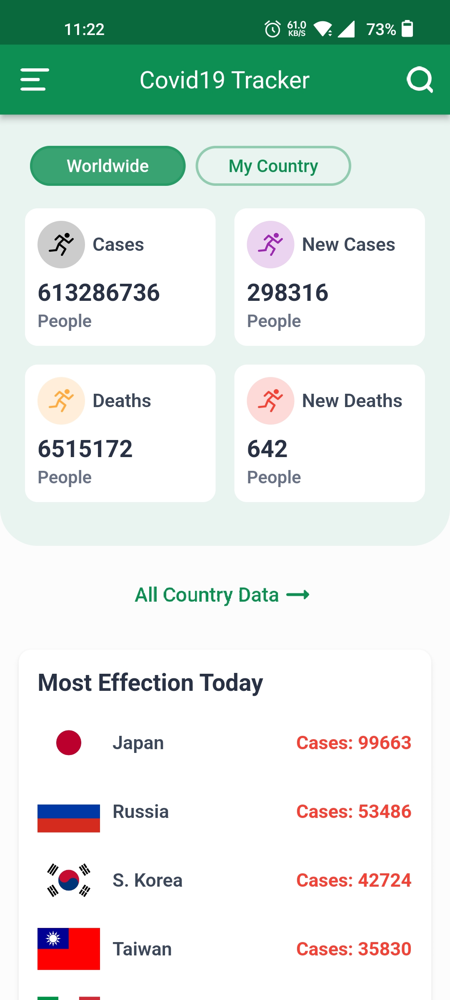
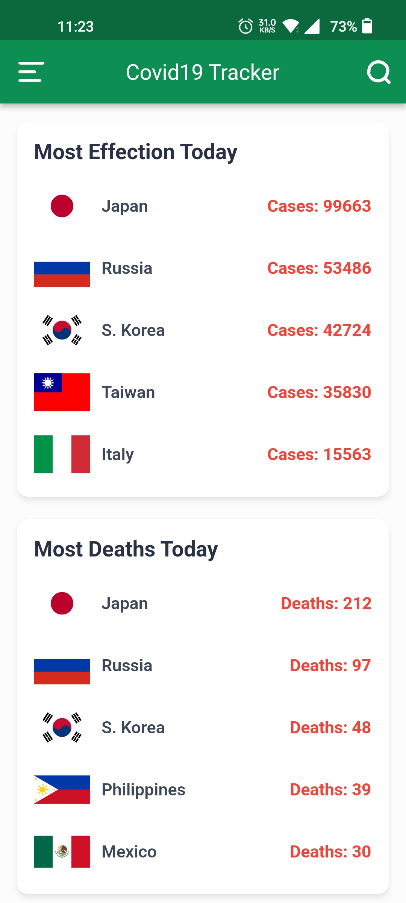
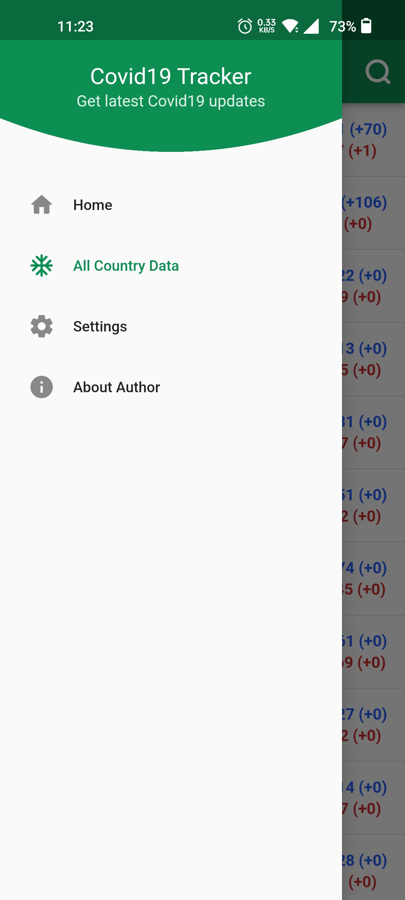
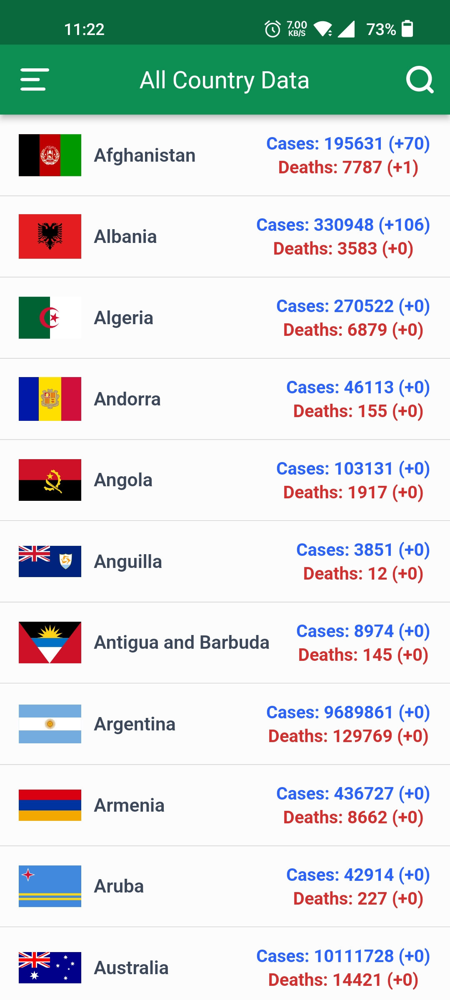
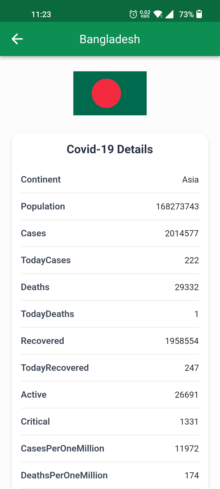

# 🦠 COVID-19 Tracker

<div align="center">

[](https://flutter.dev)
[](https://dart.dev)
[](https://github.com/Rezuanul-Islam-Fahim/covid19_tracker/blob/master/LICENSE)

[](https://github.com/Rezuanul-Islam-Fahim/covid19_tracker/actions/workflows/build-and-deploy-appetize.yml)
[](https://appetize.io/app/b_c4pr75vegtk5crqsfs7ik4xw5m)

A comprehensive COVID-19 tracking mobile application for Android & iOS devices, providing real-time global and country-specific pandemic statistics.



### 🚀 Try it Live

[](https://appetize.io/app/b_c4pr75vegtk5crqsfs7ik4xw5m)

### ⭐ Support this project

[](https://github.com/Rezuanul-Islam-Fahim/covid19_tracker/stargazers)
[](https://github.com/Rezuanul-Islam-Fahim/covid19_tracker/network/members)
[](https://github.com/Rezuanul-Islam-Fahim/covid19_tracker/watchers)

</div>

---

## 📋 Table of Contents

- [Features](#-features)
- [Screenshots](#-screenshots)
- [Getting Started](#-getting-started)
  - [Prerequisites](#prerequisites)
  - [Installation](#installation)
  - [Running the App](#running-the-app)
- [CI/CD & Deployment](#-cicd--deployment)
- [Project Structure](#-project-structure)
- [Architecture](#-architecture)
- [Technologies Used](#-technologies-used)
- [API Reference](#-api-reference)
- [Contributing](#-contributing)
- [Roadmap](#-roadmap)
- [License](#-license)
- [Contact](#-contact)
- [Acknowledgments](#-acknowledgments)

---

## ✨ Features

### 📊 Real-Time Statistics
- **Global Overview**: Track worldwide COVID-19 cases, deaths, and recoveries
- **Country-Specific Data**: Detailed statistics for individual countries
- **Live Updates**: Real-time data synchronization from reliable APIs
- **Historical Trends**: View pandemic progression over time

### 🔍 Advanced Search
- Search for any country quickly and efficiently
- Filter and sort countries by various metrics
- Autocomplete functionality for better UX

### 🎨 User Interface
- **Clean & Intuitive Design**: Material Design principles
- **Dark Mode Support**: Eye-friendly theme options
- **Responsive Layout**: Optimized for various screen sizes
- **Smooth Animations**: Enhanced user experience with fluid transitions

### 📱 Cross-Platform
- Full support for Android and iOS devices
- Consistent experience across platforms
- Native performance with Flutter

### 🌐 Offline Support
- Cached data for offline viewing
- Graceful error handling
- Network status indicators

---

## 📱 Screenshots

<p align="center">
  
  &nbsp;&nbsp;
  
  &nbsp;&nbsp;
  
</p>

<p align="center">
  
  &nbsp;&nbsp;
  
  &nbsp;&nbsp;
  
</p>

---

## 🚀 Getting Started

### Prerequisites

Before you begin, ensure you have the following installed:

- **Flutter SDK** (3.0.0 or higher)
  ```bash
  flutter --version
  ```
- **Dart SDK** (2.17.0 or higher)
- **Android Studio** or **VS Code** with Flutter extensions
- **Xcode** (for iOS development, macOS only)
- **Git**

### Installation

1. **Clone the repository**
   ```bash
   git clone https://github.com/Rezuanul-Islam-Fahim/covid19_tracker.git
   cd covid19_tracker
   ```

2. **Install dependencies**
   ```bash
   flutter pub get
   ```

3. **Verify Flutter setup**
   ```bash
   flutter doctor
   ```
   Fix any issues reported by the doctor command.

### Running the App

#### For Android
```bash
flutter run
```

#### For iOS (macOS only)
```bash
cd ios
pod install
cd ..
flutter run
```

#### Build APK (Android)
```bash
flutter build apk --release
```

#### Build IPA (iOS)
```bash
flutter build ios --release
```

---

## � CI/CD & Deployment

This project includes an automated CI/CD pipeline that builds and deploys the app to Appetize.io for instant browser-based testing.

### 🚀 Automated Deployment Features

- ✅ **Automatic APK Building** - Builds release APK on every push
- ✅ **Appetize Integration** - Deploys to Appetize.io for instant testing
- ✅ **Smart Caching** - Speeds up builds by 3x with intelligent caching
- ✅ **Version Management** - Automatic versioning with build numbers
- ✅ **Artifact Storage** - 30-day APK artifact retention
- ✅ **PR Integration** - Automatic deployment info in pull request comments

### ⚡ Build Performance

| Build Type | Duration | Status |
|------------|----------|--------|
| First Build | ~10-15 min | Full build with all dependencies |
| Cached Build | ~3-5 min | 3x faster with smart caching |

### 📚 Documentation

- **[Quick Setup Guide](.github/APPETIZE_SETUP.md)** - Get started in 5 minutes
- **[Detailed README](.github/workflows/README.md)** - Complete workflow documentation
- **[Architecture Diagram](.github/ARCHITECTURE.md)** - Visual workflow overview

### 🎯 Quick Start CI/CD

1. **Set up Appetize.io account** and get your API token
2. **Add GitHub Secret**: `APPETIZE_API_TOKEN`
3. **Push to main/master branch** - Workflow runs automatically
4. **Copy the Public Key** from workflow output
5. **Add as secret**: `APPETIZE_PUBLIC_KEY`

**That's it!** Future deployments will automatically update your app.

For detailed instructions, see the [Quick Setup Guide](.github/APPETIZE_SETUP.md).

---

## �📂 Project Structure

```
covid19_tracker/
├── lib/
│   ├── main.dart                 # App entry point
│   ├── theme.dart                # App theme configuration
│   ├── constant.dart             # App constants
│   ├── components/               # Reusable UI components
│   │   ├── body_loader.dart
│   │   ├── country_data_builder.dart
│   │   ├── country_data_panel.dart
│   │   ├── covid_data_panel.dart
│   │   ├── drawer.dart
│   │   └── search.dart
│   ├── models/                   # Data models and API handlers
│   │   ├── covid_api_handler.dart
│   │   ├── covid_info_all.dart
│   │   └── covid_info_country.dart
│   └── screens/                  # App screens
│       ├── home_screen/
│       ├── all_country_screen.dart
│       ├── country_screen.dart
│       ├── author_screen.dart
│       └── setting_screen.dart
├── assets/                       # Static assets
│   └── icons/
├── android/                      # Android-specific files
├── ios/                          # iOS-specific files
├── test/                         # Unit and widget tests
├── pubspec.yaml                  # Project dependencies
└── README.md                     # This file
```

---

## 🏗️ Architecture

This app follows a **clean architecture** pattern with clear separation of concerns:

- **Presentation Layer**: UI components and screens (`lib/screens`, `lib/components`)
- **Domain Layer**: Business logic and models (`lib/models`)
- **Data Layer**: API handlers and data sources (`lib/models/covid_api_handler.dart`)

### Key Design Patterns
- **Repository Pattern**: For data management
- **Provider Pattern**: For state management (if applicable)
- **Singleton Pattern**: For API clients

---

## 🛠️ Technologies Used

| Technology | Description |
|------------|-------------|
|  | UI framework |
|  | Programming language |
|  | API requests |
|  | Design system |

### Key Dependencies
- `http`: For making API requests
- `shared_preferences`: For local data persistence
- `provider` / `flutter_bloc`: For state management
- `intl`: For internationalization and formatting

---

## 🌐 API Reference

This application uses the [disease.sh](https://disease.sh/) COVID-19 API for real-time data.

### Endpoints Used

| Endpoint | Description |
|----------|-------------|
| `/v3/covid-19/all` | Global statistics |
| `/v3/covid-19/countries` | All countries data |
| `/v3/covid-19/countries/{country}` | Specific country data |

**API Documentation**: [https://disease.sh/docs/](https://disease.sh/docs/)

---

## 🤝 Contributing

Contributions are what make the open-source community such an amazing place to learn, inspire, and create. Any contributions you make are **greatly appreciated**.

### How to Contribute

1. **Fork the Project**
2. **Create your Feature Branch**
   ```bash
   git checkout -b feature/AmazingFeature
   ```
3. **Commit your Changes**
   ```bash
   git commit -m 'Add some AmazingFeature'
   ```
4. **Push to the Branch**
   ```bash
   git push origin feature/AmazingFeature
   ```
5. **Open a Pull Request**

### Coding Standards
- Follow [Effective Dart](https://dart.dev/guides/language/effective-dart) guidelines
- Write meaningful commit messages
- Add comments for complex logic
- Update documentation as needed

---

## 🗺️ Roadmap

- [x] Global statistics display
- [x] Country-specific data
- [x] Search functionality
- [x] Dark mode support
- [ ] Historical data charts
- [ ] Push notifications for updates
- [ ] Vaccination data tracking
- [ ] Favorites/Bookmarks feature
- [ ] Multi-language support
- [ ] Share statistics feature
- [ ] Widget for home screen

See the [open issues](https://github.com/Rezuanul-Islam-Fahim/covid19_tracker/issues) for a full list of proposed features and known issues.

---

## 📄 License

This project is licensed under the **MIT License** - see the [LICENSE](LICENSE) file for details.

### MIT License Summary

```
MIT License

Copyright (c) 2022 Rezuanul Islam Fahim

Permission is hereby granted, free of charge, to any person obtaining a copy
of this software and associated documentation files (the "Software"), to deal
in the Software without restriction, including without limitation the rights
to use, copy, modify, merge, publish, distribute, sublicense, and/or sell
copies of the Software, and to permit persons to whom the Software is
furnished to do so, subject to the following conditions:

The above copyright notice and this permission notice shall be included in all
copies or substantial portions of the Software.

THE SOFTWARE IS PROVIDED "AS IS", WITHOUT WARRANTY OF ANY KIND, EXPRESS OR
IMPLIED, INCLUDING BUT NOT LIMITED TO THE WARRANTIES OF MERCHANTABILITY,
FITNESS FOR A PARTICULAR PURPOSE AND NONINFRINGEMENT. IN NO EVENT SHALL THE
AUTHORS OR COPYRIGHT HOLDERS BE LIABLE FOR ANY CLAIM, DAMAGES OR OTHER
LIABILITY, WHETHER IN AN ACTION OF CONTRACT, TORT OR OTHERWISE, ARISING FROM,
OUT OF OR IN CONNECTION WITH THE SOFTWARE OR THE USE OR OTHER DEALINGS IN THE
SOFTWARE.
```

---

## 📧 Contact

**Rezuanul Islam Fahim**

- GitHub: [@Rezuanul-Islam-Fahim](https://github.com/Rezuanul-Islam-Fahim)
- Project Link: [https://github.com/Rezuanul-Islam-Fahim/covid19_tracker](https://github.com/Rezuanul-Islam-Fahim/covid19_tracker)

---

## 🙏 Acknowledgments

- [Flutter](https://flutter.dev/) - The amazing framework that makes this possible
- [disease.sh](https://disease.sh/) - For providing free COVID-19 API
- [Material Design](https://material.io/) - For design guidelines
- All contributors who have helped improve this project
- The open-source community for continuous inspiration

---

<div align="center">

### Made with ❤️ and Flutter

If you found this project helpful, please consider giving it a ⭐!

[](https://star-history.com/#Rezuanul-Islam-Fahim/covid19_tracker&Date)

</div>